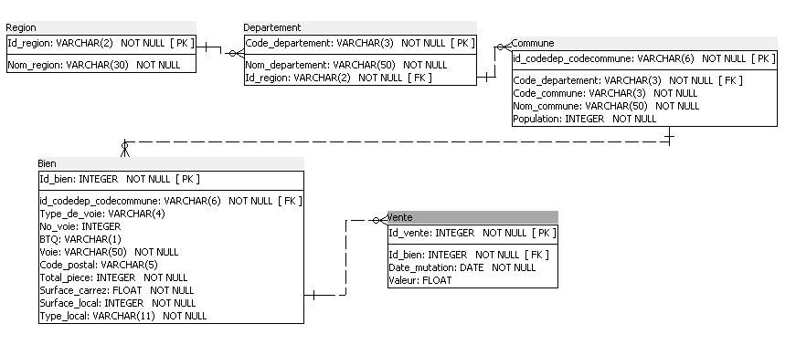
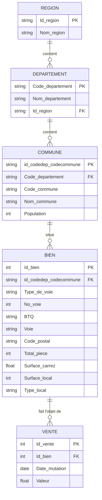
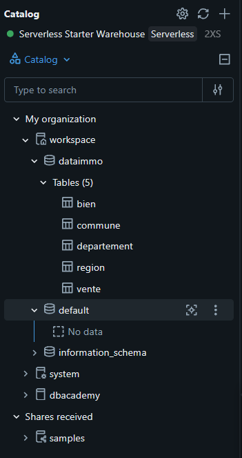
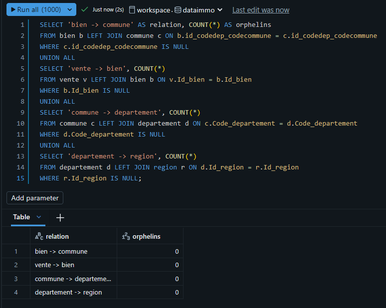
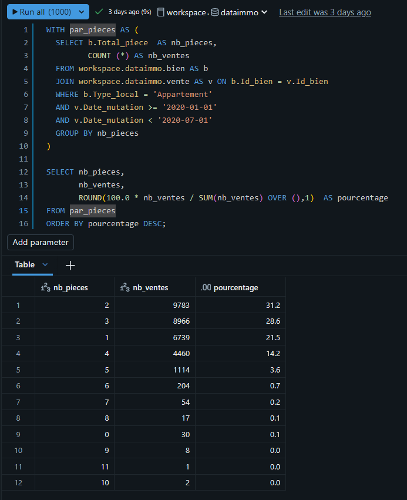
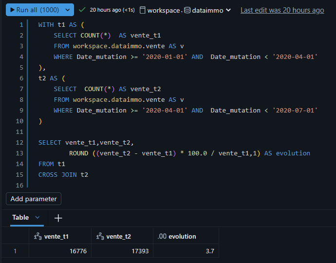
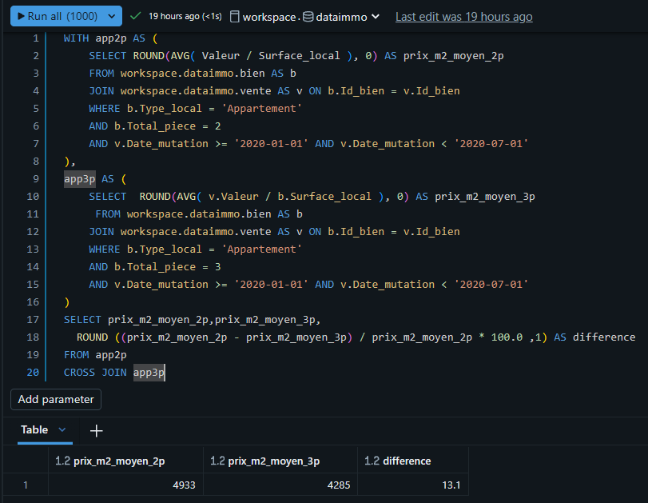

# DATAImmo : une base de données immobilière avec SQL sur Databricks

> Projet de formation (OpenClassrooms, parcours Data Analyst) : **« Créez et utilisez une base de données immobilière avec SQL »**.
> Le scénario (l'entreprise Laplace Immo et son projet DATAImmo) est fictif. Les données sont issues de jeux de données ouverts.

De fichiers bruts à une base relationnelle normalisée (3NF) hébergée dans le Cloud, puis **12 analyses SQL** pour répondre aux demandes de la direction, sur les **ventes immobilières du 1er semestre 2020 en France**.



---

## Sommaire

1. [Contexte et objectifs](#contexte-et-objectifs)
2. [Stack technique](#stack-technique)
3. [Données sources](#données-sources)
4. [Modèle de données](#modèle-de-données)
5. [Conformité RGPD](#conformité-rgpd)
6. [Reproduire le projet](#reproduire-le-projet)
7. [Contrôles qualité](#contrôles-qualité)
8. [Les 12 analyses](#les-12-analyses)
9. [Exemple : top 3 des communes par département](#exemple--top-3-des-communes-par-département)
10. [Limites et pistes d'amélioration](#limites-et-pistes-damélioration)
11. [Structure du dépôt](#structure-du-dépôt)
12. [Crédits et licence](#crédits-et-licence)

---

## Contexte et objectifs

Laplace Immo est un réseau d'agences immobilières qui veut **estimer à quel prix un bien va se vendre**. Pour cela, il lui faut une base de données fiable qui rassemble les ventes. On commence par un test (preuve de concept) sur le **1er semestre 2020**.

Ma mission :

- construire le **dictionnaire des données** ;
- concevoir un **schéma relationnel normalisé (3NF)** ;
- créer la base dans le Cloud (Databricks) en respectant le **RGPD** ;
- répondre à **12 demandes d'analyse** en SQL.

## Stack technique

| Outil | Usage |
|---|---|
| **Databricks Free Edition** | Hébergement de la base (catalogue `workspace`, schéma `dataimmo`), éditeur SQL, warehouse serverless |
| **SQL** | Création, contrôle et analyse : jointures, CTE, fonctions de fenêtre (`ROW_NUMBER`, `SUM() OVER`), `HAVING`, `CROSS JOIN` |
| **Python (pandas)** | Préparation des fichiers CSV avant envoi dans le Cloud |
| **SQL Power Architect** | Modélisation du schéma |
| **Excel** | Dictionnaire des données |

## Données sources

Trois fichiers, issus de données ouvertes (ils ne sont **pas** versionnés dans ce dépôt, voir [data/README.md](data/README.md)) :

| Fichier | Contenu | Volume |
|---|---|---|
| **DVF** (demandes de valeurs foncières), 1er semestre 2020 | Ventes de biens (appartements et maisons) | 34 169 ventes, 46 colonnes dont 17 vides |
| **INSEE** | Population des communes | 34 991 communes |
| **Référentiel géographique** | Noms des communes, départements et régions | 38 916 lignes |

## Modèle de données

Cinq tables, en **troisième forme normale** :



Les choix de conception :

- **Clé de la commune** `id_codedep_codecommune` = code du département + code de la commune (par exemple Montpellier : `34` + `172` = `34172`). Le code commune seul n'est pas unique, et un code postal peut couvrir plusieurs communes.
- **Région et département séparés de la commune** : le nom de la région dépend du département, pas de la commune. Les garder dans `Commune` créerait une dépendance transitive, interdite en 3NF.
- **Code postal dans `Bien`** : 57 communes ont plusieurs codes postaux.
- **Codes en texte** (`VARCHAR`) pour conserver les zéros initiaux (`001`, `06`).
- **Bien et Vente séparés** : une vente concerne un seul bien, mais un bien peut être revendu. Le modèle est prêt pour les années précédentes.
- **Clés étrangères** : dans Databricks, les contraintes PK/FK sont informatives. L'intégrité est donc contrôlée par requêtes (voir [Contrôles qualité](#contrôles-qualité)).

Le dictionnaire complet (3 onglets : une ligne par donnée avec code, signification, type, longueur, nature, règle de gestion) est dans [`docs/dictionnaire_de_donnees.xlsx`](docs/dictionnaire_de_donnees.xlsx).

## Conformité RGPD

- Le **nom de l'acquéreur**, seule donnée directement personnelle, est **supprimé avant tout envoi dans le Cloud** (principe de minimisation : on ne garde que ce qui sert aux analyses).
- Le dictionnaire ne contient aucune donnée personnelle.
- La pseudonymisation aurait été possible, mais les données seraient restées personnelles.
- Point de vigilance : une adresse combinée à une date et à un prix peut permettre une ré-identification indirecte. C'est pourquoi les fichiers de données ne sont pas publiés dans ce dépôt.

## Reproduire le projet

1. **Récupérer les 3 fichiers sources** et les placer à la racine du dépôt (voir [data/README.md](data/README.md)).
2. **Préparer les CSV** :
   ```bash
   pip install pandas openpyxl
   python scripts/preparation_csv.py
   ```
   Le script supprime le nom de l'acquéreur, construit les 5 tables et écrit 5 fichiers CSV dans `csv_prets/`.
3. **Créer le schéma** `workspace.dataimmo` dans Databricks, puis importer les CSV avec *Add data* dans l'ordre : `region`, `departement`, `commune`, `bien`, `vente`. Les codes sont importés en `STRING`, la valeur en `DOUBLE`, la date en `DATE`. Les identifiants `Id_bien` et `Id_vente` sont générés automatiquement.
4. **Lancer les contrôles** : [`sql/controles.sql`](sql/controles.sql).
5. **Lancer les analyses** : [`sql/requetes_analyse.sql`](sql/requetes_analyse.sql).



## Contrôles qualité

| Contrôle | Résultat attendu |
|---|---|
| Nombre de lignes : `region`, `departement`, `commune`, `bien`, `vente` | 17 · 100 · 34 991 · 34 169 · 34 169 (identique aux CSV) |
| Orphelins sur les 4 relations (`LEFT JOIN … IS NULL`) | 0 partout |
| Codes postaux commençant par `0` conservés | 2 067 |
| Clé commune différente de département + commune | 0 |



## Les 12 analyses

Toutes les analyses portent sur le **1er semestre 2020**.

| N° | Demande | Techniques | Résultat clé |
|---|---|---|---|
| D01 | Nombre d'appartements vendus | Jointure, `COUNT` | **31 378** |
| D02 | Ventes d'appartements par région | Chaîne de jointures, `GROUP BY` | Île-de-France : 13 995 (44,6 %) |
| D03 | Part des ventes par nombre de pièces | CTE, `SUM() OVER ()` | 2 pièces 31,2 % · 3 pièces 28,6 % |
| D04 | 10 départements au prix au m² le plus élevé | `AVG(Valeur / Surface_local)` | Paris : 12 129 €/m² |
| D05 | Prix moyen au m² d'une maison en Île-de-France | Filtres | 3 998 €/m² (1 059 ventes) |
| D06 | 10 appartements les plus chers | `ORDER BY … LIMIT` | 9 000 000 € (10 m², Paris 16e) |
| D07 | Évolution du nombre de ventes T1 → T2 | 2 CTE, `CROSS JOIN` | **+3,7 %** (16 776 → 17 393) |
| D08 | Classement des régions, appartements de plus de 4 pièces | Filtres, `AVG` | Île-de-France : 8 015 €/m² |
| D09 | Communes avec au moins 50 ventes au T1 | `GROUP BY`, `HAVING` | 48 communes (Paris 17e : 228) |
| D10 | Écart de prix au m² entre 2 pièces et 3 pièces | 2 CTE, `CROSS JOIN` | 3 pièces : **13,1 % moins cher** |
| D11 | Valeur moyenne du top 3 des communes de 5 départements | CTE, `ROW_NUMBER() OVER (PARTITION BY …)` | Saint-Jean-Cap-Ferrat : 968 750 € |
| D12 | 20 communes avec le plus de ventes pour 1 000 habitants (plus de 10 000 hab.) | Jointure INSEE, calcul de ratio | Paris 2e : 5,8 ventes pour 1 000 hab. |

Captures de quelques résultats :

| D03 | D07 | D10 |
|---|---|---|
|  |  |  |

## Exemple : top 3 des communes par département

Pour classer les communes **dans chaque département**, on calcule d'abord les statistiques par commune (première CTE), puis un rang par département avec `ROW_NUMBER() OVER (PARTITION BY …)` (seconde CTE). On filtre ensuite sur le rang : c'est pourquoi la CTE est nécessaire, un `WHERE` ne pouvant pas porter directement sur un rang calculé dans la même requête.

```sql
WITH par_commune AS (
  SELECT c.Code_departement,
         c.id_codedep_codecommune,
         c.Nom_commune,
         COUNT(*) AS nb_ventes,
         ROUND(AVG(v.Valeur), 0) AS valeur_moyenne
  FROM workspace.dataimmo.vente AS v
  JOIN workspace.dataimmo.bien AS b ON v.Id_bien = b.Id_bien
  JOIN workspace.dataimmo.commune AS c ON b.id_codedep_codecommune = c.id_codedep_codecommune
  WHERE v.Date_mutation >= '2020-01-01' AND v.Date_mutation < '2020-07-01'
    AND c.Code_departement IN ('06', '13', '33', '59', '69')
  GROUP BY c.Code_departement, c.id_codedep_codecommune, c.Nom_commune
),
classement AS (
  SELECT *,
         ROW_NUMBER() OVER (PARTITION BY Code_departement ORDER BY valeur_moyenne DESC) AS rang
  FROM par_commune
)
SELECT Code_departement, Nom_commune, nb_ventes, valeur_moyenne, rang
FROM classement
WHERE rang <= 3
ORDER BY Code_departement, valeur_moyenne DESC;
```

## Limites et pistes d'amélioration

**Limites des données**

- La valeur déclarée couvre parfois plusieurs lots (un prix de 9 M€ pour 10 m² n'est pas fiable).
- L'Alsace-Moselle est absente et les DOM sont peu représentés.
- Les moyennes sont sensibles aux valeurs extrêmes. Certains classements (D11) contiennent des communes avec une seule vente.
- Certains noms de communes sont mal encodés dans le fichier INSEE.
- Le prix au m² utilise la surface du local, car la surface Carrez ne concerne que le premier lot.

**Pistes**

- Généraliser aux **années précédentes** : la table `vente` est déjà séparée de `bien`.
- **Automatiser l'import** des fichiers (jobs planifiés dans Databricks).
- Préparer un **modèle de prévision des prix** : objectif final du projet DATAImmo, la base fournit les données propres et structurées.

## Structure du dépôt

```
dataimmo-sql-databricks/
├── README.md
├── LICENSE
├── .gitignore
├── docs/
│   ├── dictionnaire_de_donnees.xlsx
│   └── images/
│       ├── 01_schema_relationnel.png
│       ├── 02_D03.png
│       ├── 03_D07.png
│       ├── 04_D10.png
│       ├── 05_controles_orphelins.png
│       └── 06_catalog.png
├── sql/
│   ├── controles.sql
│   └── requetes_analyse.sql
├── scripts/
│   └── preparation_csv.py
└── data/
    └── README.md
```

## Crédits et licence

- Projet réalisé dans le cadre de la formation **Data Analyst d'OpenClassrooms**. Le scénario, l'entreprise et les personnages sont fictifs.
- Données : jeux de données ouverts (DVF, INSEE, référentiel géographique). Consulter les conditions de réutilisation des sources avant tout réemploi.
- Code et requêtes : licence [MIT](LICENSE).

**Auteur** : Ahmed Moundji Zid
